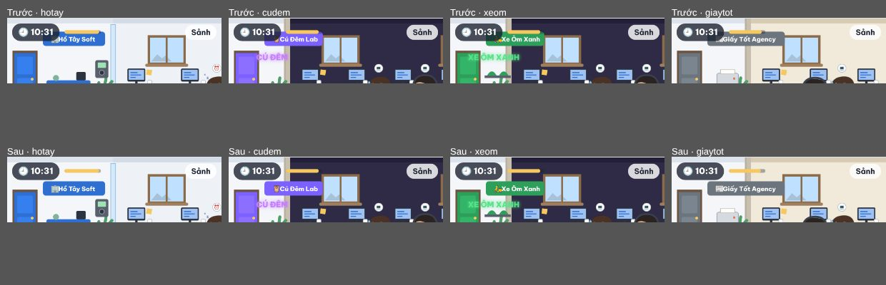
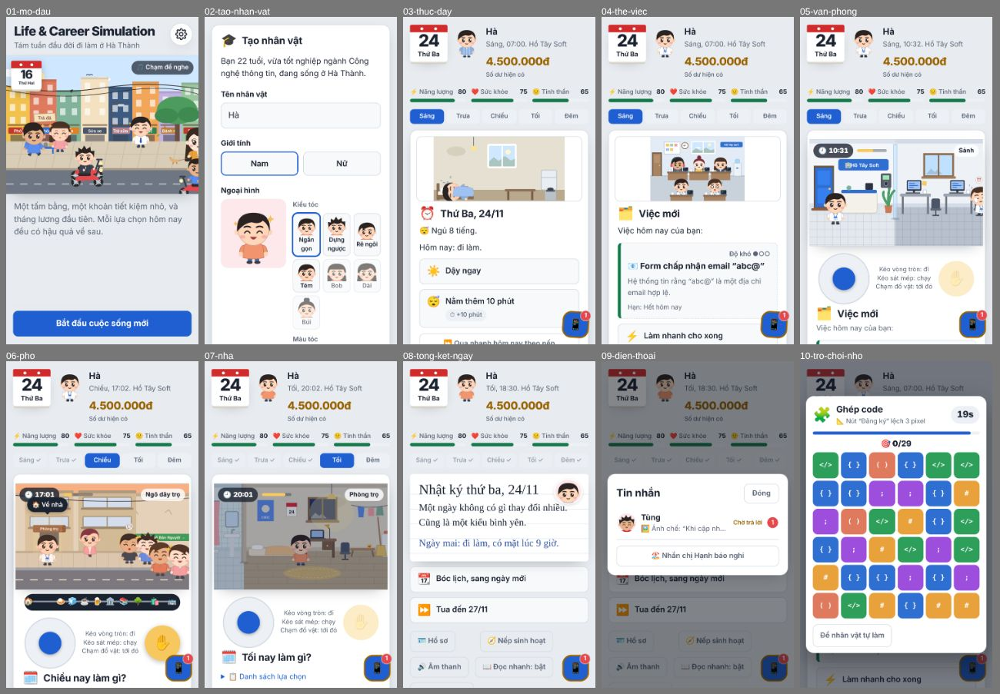
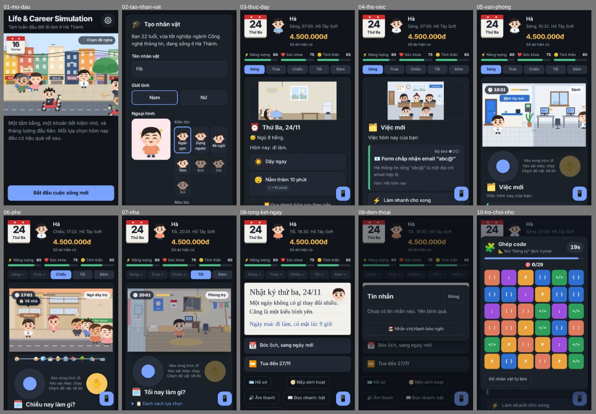
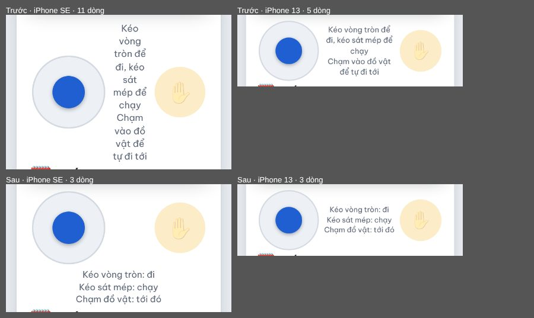

# Báo cáo – Life & Career Simulation v17.9 (Ổn định và dọn lỗi)

**Mục tiêu:**
- sửa các bài kiểm thử chập chờn theo đúng nguyên nhân;
- dọn các lỗi nhỏ còn tồn: P3-06, P3-07, P3-10, câu NPC chưa đổi thuật ngữ;
- rà 10 màn hình hay gặp trên điện thoại.

**Không làm ở phase này** (theo yêu cầu):
- ngày bình thường tự chạy;
- chỉnh độ khó trò chơi nhỏ (chờ chơi thử với người thật).

**Không đổi:** lối chơi, tài chính, lương, năng lượng, sức khỏe, hệ thống 56 ngày, điều khiển, bản lưu.

Báo cáo trước: `docs/AUDIT_REPORT_v17.8.md`. Ảnh trước/sau: `docs/anh-v17.9/`.

## 1. Kiểm thử chập chờn

Nguyên tắc: tìm nguyên nhân rồi sửa cách đo; **không hạ ngưỡng nào**.

| Bộ | Kiểm tra | Nguyên nhân | Cách sửa |
|---|---|---|---|
| `mo-dau` | Mở/đóng Cài đặt giữa lúc nhân vật đang nói | Bài chờ một câu nói **ngẫu nhiên** tới 50 giây. Máy bận thì có lần không có câu nào | Thêm móc kiểm thử `TITLE_DEBUG.noi()` cho nhân vật nói ngay. Sau đó chờ theo điều kiện (`waitForFunction`, tối đa 5 giây), không chờ theo thời gian cố định |
| `tro-choi-moi` | Rò bộ nhớ sau 20 lượt chơi | So **2 mốc**. Mốc đầu (sau lượt thứ 4) có lúc thấp bất thường khi máy chạy song song bài khác, nên mốc cuối trông như tăng | Đo **5 mốc** (sau mỗi 4 lượt). Chỉ báo rò khi số nút trang hay trình nghe sự kiện tăng đều qua cả 5 mốc **và** mốc cuối cao hơn hai mốc đầu quá 10% |
| `hieu-nang` | Rò bộ nhớ khi ra vào địa điểm | Cùng kiểu, 2 mốc | 5 mốc, cùng quy tắc, ngưỡng cũ (`NGUONG.TANG`) |
| `hieu-nang` | Khung/giây trên phố giờ cao điểm ≥ 40 | Một lần đo 6 giây. Máy bận đúng lúc đo thì tụt | Đo 2 lần, lấy lần tốt hơn. In cả 2 số. **Ngưỡng 40 giữ nguyên** |
| `van-phong-di-lai` | "Xếp code: chơi kém thì điểm âm" (lộ ra ở lần chạy `npm test` đầu tiên của phase này) | "Chơi kém" chỉ bấm Xong ngay. Thứ tự dòng được **xáo ngẫu nhiên**, đôi khi có sẵn nhiều dòng đúng chỗ nên điểm ra 0 thay vì âm | Chơi kém thì xếp **ngược** hẳn rồi mới bấm Xong. Kết quả không còn phụ thuộc may rủi. Luật trò chơi không đổi |
| `56-ngay` | "Phong nhắc chuyện vừa nghỉ" | Đã sửa ở v17.7 (hạt giống cố định). Kiểm lại: vẫn ổn | Không đổi |

**Ghi chú về bộ nhớ heap (bài `hieu-nang`, ra vào 20 lần):**
- Số nút trang (3281 → 2547, cả 4 mốc sau giống nhau) và trình nghe sự kiện (69 → 60) **không tăng**.
- Heap JS: 3046 → 3233 → 3312 → 3345 → 3365 KB (lần chạy sau: 3056 → 3243 → 3320 → 3353 → 3381). Có tăng, nhưng tăng chậm dần (+187, +79, +33, +20), giống bộ nhớ đệm đang đầy dần hơn là rò. Kiểm tra heap vẫn đạt, vì mốc cuối không cao hơn hai mốc đầu quá ngưỡng. Nên theo dõi ở lần sau.

## 2. Lỗi nhỏ đã sửa

Mỗi lỗi có một kiểm tra mới. Tôi đã chạy kiểm tra đó trên **bản cũ** để chắc nó bắt được lỗi (hỏng), rồi chạy trên bản mới (đạt).

### 2.1. P3-07: biển tên công ty đè lên đồng hồ và thanh thời gian

*Trên: trước (biển nằm ngay dưới đồng hồ, đè lên thanh thời gian). Dưới: sau.*

- **Nguyên nhân:** biển ở độ cao 22, trùng vùng đồng hồ và thanh thời gian (lớp nổi trên khung thế giới).
- **Sửa:**
  - dời biển xuống 40 (`js/van-phong/do-dac-van-phong.js`);
  - ở Cú Đêm Lab và Xe Ôm Xanh, chữ neon trên tường hạ từ 70 xuống 84 để biển không che (`js/van-phong/ban-do-cong-ty.js`).
- **Kiểm tra mới** (`van-phong-di-lai`, cả 8 văn phòng): khung biển tên không chạm đồng hồ, thanh thời gian, chữ neon. Bản cũ: hỏng ở cả 8 (chạm đồng hồ).

### 2.2. P3-06: đồng nghiệp đi xuyên mép bàn khi rời ghế

- **Nguyên nhân:**
  - Ghế chỉ cách mép dưới của bàn 1–2 điểm ảnh.
  - Hàm kiểm tra "đi thẳng từ A tới B có vướng không" (`roamLine`) dò cách **3 điểm ảnh** một lần. Đường đi chéo từ ghế cắt qua góc bàn mà không bị phát hiện.
  - Không riêng anh Dũng: ai rời ghế đi sang trái hay đi chéo cũng bị.
- **Thêm một lỗi cùng họ:** khi điểm đến nằm sát vách ngăn, ô lưới của nó bị tính là vướng. Thuật toán tìm đường không tìm ra đường, nên nhân vật đi thẳng **xuyên vách** (ví dụ ở Cú Đêm Lab, sang phòng họp).
- **Sửa** (`js/the-gioi/di-chuyen.js`, `js/the-gioi/ban-do-nha.js`):
  - dò từng điểm ảnh (`ROAM.DO = 1`);
  - điểm đến bị vướng thì dùng ô trống gần nhất đi thẳng tới được, giống cách đã làm với điểm xuất phát.
- **Đo:**
  - từ mỗi ghế đi tới mọi đồ vật và mọi bàn, ở 4 kiểu văn phòng, dò từng điểm ảnh;
  - trước: **235/490** đường chạm bàn hay vách (Hồ Tây 51, Bánh Mì Pay 38, Cú Đêm Lab 106, Lò Rèn 40);
  - sau: **0**.
- **Quan sát thật** (`tests/audit/quan-sat.js`, 8 giờ trong game, 4 văn phòng, CPU chậm 4 lần, trước khi sửa):
  - chỉ thấy 1 mẫu ở Bánh Mì Pay (anh Phong);
  - lỗi hiếm khi lộ vì mỗi lần chỉ chạm vài điểm ảnh, trong chưa tới nửa giây;
  - kiểm tra bằng đường đi như trên thì chắc chắn hơn.
- **Kiểm tra mới** (`van-phong-di-lai`, 8 văn phòng): bản cũ hỏng, bản mới đạt.
- Hàm này cũng dùng cho người chơi chạm để đi và NPC ở nhà, phố, quán. Các bài `the-gioi`, `ra-pho`, `npc-on-dinh`, `hieu-nang` (đo thời gian tìm đường) đều chạy lại trong `npm test` (mục 4).

### 2.3. P3-10: bài chơi ngẫu nhiên cần 6 GB

- **Nguyên nhân:**
  - 40 lượt chạy liền một mạch trong một vòng lặp, không lần nào nhường lại cho Node.
  - Cửa sổ jsdom đã đóng chưa được dọn hẳn.
  - Bộ nhớ chỉ được trả lại khi gần chạm giới hạn, nên phải đặt giới hạn rất cao.
- **Sửa** (`tests/choi-ngau-nhien.js`):
  - sau mỗi lượt nghỉ một nhịp (`setTimeout 0`) cho jsdom dọn;
  - giới hạn bộ nhớ trong `package.json` và `chay-tat-ca.js`: 6144 → **1024 MB**.

| Chạy 40 lượt, giới hạn 1 GB | Kết quả |
|---|---|
| Bản cũ | **Hết bộ nhớ**, dừng giữa chừng (`JavaScript heap out of memory`) |
| Bản mới | Đủ 40 lượt, đạt. Bộ nhớ cao nhất **464 MB**. Heap còn lại sau mỗi lượt 100–260 MB, không tăng dần |

### 2.4. Đọc nhanh: câu NPC tự nói chưa đổi thuật ngữ

- **Nguyên nhân:** Đọc nhanh đổi chữ trong cảnh thẻ. Bong bóng thoại trong thế giới đi lại do hàm `say` của sân khấu vẽ thẳng nên không đi qua bước đổi chữ.
- **Sửa** (`js/hinh-anh/san-khau.js`): `say` gọi `dnChu`.
  - Đổi nhiều lần vẫn ra như nhau, nên câu đã đổi trong cảnh thẻ không bị đổi hai lần.
  - Tắt Đọc nhanh thì giữ nguyên.
- **Kiểm tra mới** (`doc-nhanh`, nền sáng và tối): "Fix bug của task này rồi review nhé" thành "Fix lỗi của việc này rồi xem lại nhé" khi bật, giữ nguyên khi tắt. Bản cũ: hỏng.

## 3. Điện thoại: 10 màn hình hay gặp

Chụp trên iPhone 13 giả lập, nền sáng và tối:
1. mở đầu;
2. tạo nhân vật;
3. thức dậy;
4. thẻ việc;
5. văn phòng;
6. phố;
7. nhà buổi tối;
8. nhật ký cuối ngày;
9. điện thoại;
10. trò chơi nhỏ.

**Kết quả:** không màn nào tràn ngang, không lỗi trang, chữ đọc được ở cả hai nền.

**Đã sửa (nhỏ, an toàn):**

- **Dòng hướng dẫn cạnh vòng tròn điều khiển** (văn phòng, phố, nhà):
  - trên iPhone SE chỉ rộng 50 điểm ảnh, gãy thành **11 dòng**;
  - trên iPhone 13 là 5 dòng, câu bị ngắt giữa chừng ("Kéo vòng tròn để / đi, kéo sát mép để / chạy").
- **Cách sửa** (`css/the-gioi.css`, `js/the-gioi/the-gioi.js`):
  - màn hình hẹp hơn 360 điểm ảnh: dòng hướng dẫn xuống hàng riêng;
  - câu ngắn lại: "Kéo vòng tròn: đi / Kéo sát mép: chạy / Chạm đồ vật: tới đó";
  - kết quả: **3 dòng** trên iPhone SE, iPhone 13, Pixel 5.
- **Kiểm tra mới:** `the-gioi`, 3 máy.

**Đã xem, không phải lỗi:**
- **Nút điện thoại 📱 nổi** đè lên mép phải nút lựa chọn khi đang cuộn. Cuộn xuống cuối thì không che nút nào, vì trang đã chừa 72 điểm ảnh. Đây là cách nút nổi vẫn hoạt động.
- **Nhật ký cuối ngày** giữ nền giấy trắng ở nền tối. Đây là thiết kế "trang nhật ký".

**Còn lại (chưa sửa, cần quyết định hoặc ngoài phạm vi):**
- Ở màn mở đầu, nút "Chạm để nghe" có một biểu tượng hiện thành ô trống trong trình duyệt kiểm thử, có thể do thiếu phông biểu tượng. Cần xem trên điện thoại thật.
- iPhone SE: khi cuộn để vòng tròn điều khiển nằm sát đáy màn hình, nút điện thoại 📱 nổi có lúc che nút ✋. Cuộn lên một chút thì thấy. Sửa cần đổi chỗ nút nổi khi đang ở thế giới đi lại; chưa làm vì đụng đến điều khiển.
- Thẻ thức dậy: lựa chọn thứ 3 ("Qua nhanh hôm nay…") nằm dưới màn hình đầu. Hai lựa chọn chính vẫn hiện ngay.

## 4. Kiểm thử

`npm test` chạy 3 lần liên tiếp, mỗi lần toàn bộ 26 bộ:

| Lần | ĐẠT | KHÔNG ĐẠT | SKIP | CHƯA CHẠY | BÁO CÁO | Kiểm tra | Phố giờ cao điểm (2 lần đo) |
|---|---|---|---|---|---|---|---|
| 1 (trước khi sửa bài "Xếp code") | 23 | **1** (`van-phong-di-lai`: Xếp code, xem mục 1) | 0 | 0 | 2 | 769 đạt, 1 hỏng | 51,6 (51,6; 51) |
| 2 | **24** | **0** | 0 | 0 | 2 | 770 đạt, 0 hỏng | 42,8 (38,9; 42,8) |
| 3 | **24** | **0** | 0 | 0 | 2 | 770 đạt, 0 hỏng | 53,8 (48,9; 53,8) |
| 4 | **24** | **0** | 0 | 0 | 2 | 770 đạt, 0 hỏng | 50,1 (46,6; 50,1) |

- **3 lần liên tiếp sau khi sửa (lần 2–4): không có bộ KHÔNG ĐẠT.** Đạt mục tiêu.
- Lần 1 lộ thêm một kiểm tra chập chờn (Xếp code). Tôi đã sửa rồi chạy lại đủ 3 lần.
- 2 bộ BÁO CÁO (`can-bang`, `hai-thang`) chỉ in số liệu cân bằng, không có tiêu chí đạt/không đạt; cả 3 lần đều chạy xong không lỗi.
- **Lưu ý trung thực về tốc độ phố:** ở lần 2, lần đo đầu chỉ được 38,9 khung/giây, dưới ngưỡng 40. Lần đo thứ hai đạt 42,8 nên kiểm tra đạt. Máy kiểm thử có 4 nhân và chạy song song nhiều việc, nên số đo còn dao động (38,9–53,8). Ngưỡng 40 giữ nguyên. Nếu một ngày cả hai lần đo đều dưới 40, đó là tín hiệu thật cần xem lại, không phải lỗi bài kiểm thử.

**Bài kiểm thử mới / đổi:**
- `van-phong-di-lai`:
  - biển tên không đè đồng hồ, thanh thời gian, chữ neon (8 văn phòng);
  - đường từ ghế không cắt mép bàn, vách (8 văn phòng).
- `doc-nhanh`: câu NPC tự nói đổi thuật ngữ (sáng, tối).
- `the-gioi`: hướng dẫn điều khiển 3 dòng (3 máy).
- `mo-dau`, `tro-choi-moi`, `hieu-nang`: cách đo mới (mục 1).
- `ngau-nhien`: chỉ cần 1 GB.

## 5. Còn lại

1. **Ngày bình thường tự chạy** (để giảm chữ tới 50%): để phase sau, theo yêu cầu.
2. **Chơi thử 4 trò chơi nhỏ với người thật:** chưa có, nên chưa chỉnh độ khó.
3. **Tốc độ:** phần còn tốn nhất là chia lớp và kiểu dáng của nhân vật (tay chân chuyển động bằng CSS). Giảm tiếp cần làm lại cách vẽ nhân vật. Chưa đo trên điện thoại thật.
4. **Heap JS khi ra vào nhiều lần:** tăng chậm dần (mục 1). Nên theo dõi.
5. **P3-12:** nhiều file nhỏ (hơn 80 lượt tải). Chưa đo thời gian tải qua mạng thật.
6. Hai điểm nhỏ trên điện thoại ở mục 3.
