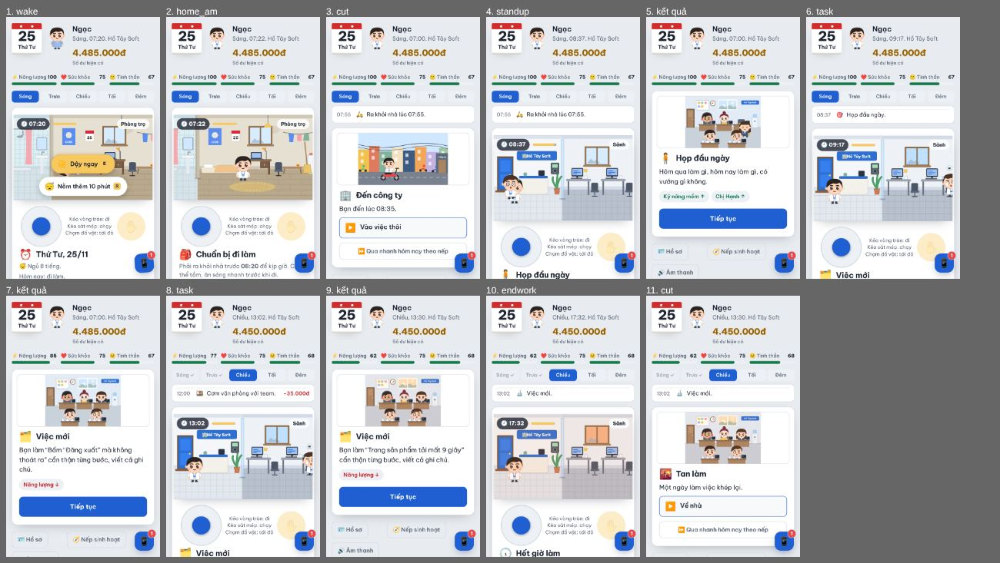
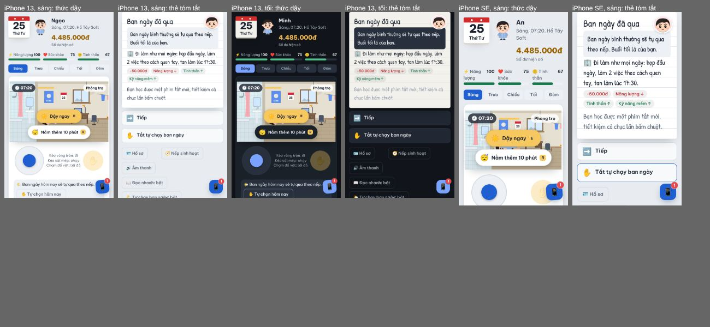

# Báo cáo – Life & Career Simulation v18.0 (Ngày bình thường tự chạy ban ngày)

**Mục tiêu:** người chơi lướt nhanh qua phần lặp lại của ngày làm việc (đi làm, việc thường ngày) và dành thời gian cho phần "sống" (buổi tối, người quen, quán xá, chuyện tự nảy sinh).

**Quyết định của bạn (trả lời trước khi làm):**
1. Tự chạy bật sẵn.
2. Buổi tối luôn giữ lại cho người chơi.
3. Dừng nhiều (cả chuyện nhỏ với người quen).
4. Thẻ tóm tắt chờ bấm "Tiếp".

**Không đổi:** tài chính, lương, năng lượng, sức khỏe, hệ thống 56 ngày, điều khiển, bản lưu, độ khó trò chơi nhỏ.

Báo cáo trước: `docs/AUDIT_REPORT_v17.9.md`. Ảnh: `docs/anh-v18.0/`.

## 1. Khảo sát (trước khi làm)

Công cụ: `tests/audit/khao-sat-tu-chay.js`.
- 6 ván trọn 56 ngày (2 hạt giống × 3 hoàn cảnh), tự chạy tắt, Đọc nhanh bật, chế độ thẻ.
- Bot chơi theo nếp: dậy, ăn, ngủ đúng giờ; tìm việc và phỏng vấn tử tế (có việc khoảng ngày 3–8 như người chơi bình thường); cảnh khác chọn đa dạng.

**Trung bình mỗi ván: 566 lần bấm, 30.137 từ.**

| Cảnh | Lần/ván | Bấm/ván | Từ/ván | Loại | Lý do |
|---|---|---|---|---|---|
| Thức dậy | 56 | 56 | 2.111 | giữ lại | Có lựa chọn thật (dậy hay nằm thêm, dẫn tới đi làm muộn). Từ v18.0 là chỗ đặt nút "Tự chọn hôm nay" |
| Task buổi sáng + màn kết quả | 37 + 37 | 74 | 4.823 | **LẶP LẠI** | Làm theo cách quen tay, ngày nào cũng giống nhau |
| Tan làm + màn kết quả | 18,5 + 14,7 | 33 | 1.767 | phần lớn ĐÁNG DỪNG | Hiện ra khi được nhờ OT, còn việc dang dở, được rủ đi trà đá. Tan làm bình thường đã tự qua từ v17 |
| Lỗi cũ quay lại + kết quả | 15 + 15 | 30 | 2.053 | ĐÁNG DỪNG | Hậu quả của lựa chọn trước |
| Sự kiện ở công ty (cà phê, review…) | ~10 | ~20 | ~1.000 | ĐÁNG DỪNG | Sự kiện, ngày đặc biệt |
| Giờ rảnh + kết quả (tối, ngày nghỉ) | 76 + 67 | 143 | 6.276 | buổi tối, cuối tuần | Không bao giờ tự chạy |
| Nhật ký cuối ngày | 56 | 56 | 3.684 | buổi đêm | Không tự chạy |

**Lần bấm theo buổi** (mỗi ván): chưa có việc 28, ngày nghỉ 171, sáng 143, trưa 2, chiều 73, tối 102, đêm 40, tổng kết tuần 7.

**Phát hiện quan trọng: chế độ thẻ và chế độ đi lại khác nhau rất xa.**
- **Chế độ thẻ** (tắt "Tự đi lại trong nhà"): từ v17, họp đầu ngày, task buổi chiều, tan làm bình thường, phân cảnh đến công ty… đã tự qua. Phần lặp lại còn lại chỉ là **task buổi sáng và màn kết quả của nó**, khoảng 13% lần bấm.
- **Chế độ đi lại** (mặc định): cả ban ngày nằm trong thế giới đi lại. Phải ra cửa, đi tới chỗ họp, tới bàn, tới cửa lúc tan làm. Đây mới là phần tốn nhiều nhất.
  - Khảo sát jsdom không chạy được chế độ này, nên tôi đo trên trình duyệt thật (mục 4).

## 2. Thiết kế đã làm

| Phần | Cách làm | File |
|---|---|---|
| Việc LẶP LẠI ban ngày (`TC_LAP`) | Chuẩn bị ra khỏi nhà, phân cảnh đến/rời công ty, họp đầu ngày (báo cáo ngắn gọn), task theo cách quen tay (trừ task đầu tiên ở công ty), tan làm bình thường | `js/loi/tu-chay.js` |
| Áp dụng lựa chọn | Dùng **đúng hàm `settleChoice`** như khi người chơi bấm (nếp sinh hoạt, trí nhớ NPC, nhật ký trong ngày đều như cũ). Chỉ bỏ màn hình kết quả. Không dùng chế độ tua nhanh cũ (`S.fast`), vì chế độ đó tắt sự kiện, tin nhắn, chuyện tự nảy sinh | `js/loi/tu-chay.js`, `js/loi/xep-lich-ngay.js` |
| Cảnh ĐÁNG DỪNG | Mọi cảnh khác (sự kiện, ngày đặc biệt, chuyện tự nảy sinh, lỗi quay lại, được nhờ OT, được rủ đi chơi, lương, tổng kết tháng…) hiện như cũ. Tự chạy chạy tới đúng cảnh đó, dừng, rồi chạy tiếp | như trên |
| Điểm dừng bắt buộc | Xem bảng dưới | `js/loi/tu-chay.js`, ngưỡng trong `js/du-lieu/tu-chay.js` |
| Buổi tối, đêm, cuối tuần, ngày nghỉ | Không bao giờ tự chạy | như trên |
| Thẻ tóm tắt | Đầu buổi tối, nếu hôm đó có tự chạy. Tối đa 3 dòng: đã làm gì; tiền và các chỉ số chính thay đổi (tối đa 4 thẻ); một chi tiết đời thường ở công ty (chọn theo ngày, không dùng số ngẫu nhiên của game). Chờ bấm "Tiếp". Lần đầu thêm một dòng giải thích và nút "Tắt tự chạy ban ngày" | `js/loi/tu-chay.js`, câu chữ ở `js/du-lieu/tu-chay.js` |
| "Tự chọn hôm nay" | Ở **màn thức dậy**, cùng dòng "Ban ngày hôm nay sẽ tự qua theo nếp" | `js/giao-dien/tu-chay.js` |
| Bật/tắt | Nút "🌤️ Tự chạy ban ngày" ở cuối màn hình, công tắc trong Cài đặt. Mặc định bật. Lưu trong trình duyệt như Đọc nhanh, không nằm trong bản lưu | `index.html`, `js/giao-dien/tu-chay.js`, `js/giao-dien/man-mo-dau.js` |

**Điểm dừng bắt buộc** (việc lặp lại không tự chạy):

| Khi | Ghi chú |
|---|---|
| Lần đầu gặp việc đó | Ván mới: ngày làm thứ hai vẫn tự chơi họp, task. Bản lưu cũ đã qua ngày 1: coi như đã gặp |
| Ngày đặc biệt ở công ty (review, khách đến, chạy hạn chót, demo, team building) | Cả ban ngày để người chơi tự chơi. Văn phòng hôm đó có chuyện riêng (khách ngồi ở chỗ họp, anh Dũng sang bàn…) |
| Năng lượng dưới 30, sức khỏe dưới 40, tinh thần dưới 30 | |
| Tiền dưới 300.000đ, hoặc hóa đơn đến hạn trong 2 ngày mà không đủ tiền | Mỗi đợt thiếu tiền, mỗi hóa đơn dừng một lần |
| Đi làm muộn, hay còn mệt vì tối qua | |
| Có tin nhắn mới chưa trả lời | Mỗi tin dừng một lần. Không trả lời thì việc sau vẫn tự chạy |
| Đồng nghiệp có chuyện cũ muốn nhắc | Chỉ khi chơi chế độ đi lại: dừng ở văn phòng để gặp họ. Chế độ thẻ không có lúc nhắc chuyện nên không dừng |
| Bấm "Tự chọn hôm nay", hoặc tắt tự chạy | |

**Khác với bản đề xuất:**
- Nút "Tự chọn hôm nay" nằm ở màn thức dậy, không nằm trên thẻ tóm tắt, vì đến lúc hiện thẻ tóm tắt thì ban ngày đã qua.
- Màn thức dậy vẫn hiện, vì đó là lựa chọn thật. Mỗi ngày bình thường còn 2 lần bấm: dậy và "Tiếp".

### 2.1. Sửa nền: phần vẽ dùng số ngẫu nhiên riêng

Khi thử "bật và tắt tự chạy cho cùng kết quả", lần đầu **không đạt**: sự kiện buổi tối khác nhau (một bên Tùng rủ đi bia, một bên Linh rủ đi học).
- **Nguyên nhân:**
  - vẽ một màn hình (hình nhân vật, hoạt cảnh, âm thanh) cũng gọi số ngẫu nhiên chung với luật chơi;
  - bỏ qua một màn hình thì cả dãy số phía sau lệch đi.
  - Đây là lỗi nền có từ trước. Chỉ khi tự chạy bỏ qua màn hình thì nó mới lộ ra.
- **Sửa** (`js/giao-dien/man-choi.js`):
  - Trong lúc vẽ (`renderScene`, màn kết quả, lời thoại), `Math.random` tạm là một bộ số riêng (`veRieng`).
  - Màn hình dùng lại cảnh mà vòng chạy vừa dựng, không dựng lần hai.
  - Luật chơi, tỷ lệ không đổi.
- Sau khi sửa: 3/3 hoàn cảnh cho cùng kết quả (mục 4).

## 3. Ảnh trước/sau (điện thoại)

**Trước (tắt tự chạy), một ngày làm việc bình thường, iPhone 13:** 11 màn hình ban ngày. 4 màn ở văn phòng còn phải đi tới chỗ.

**Sau (bật tự chạy):** màn thức dậy (có dòng báo trước và nút "Tự chọn hôm nay") và thẻ tóm tắt, trên iPhone 13 nền sáng, nền tối, iPhone SE. Thẻ tóm tắt được cuộn lên đầu màn hình nên thấy cả thẻ và nút "Tiếp" mà không phải cuộn.

## 4. Kiểm thử và số đo

**Bộ mới `tu-chay`** (`npm run tu-chay`, khoảng 6 phút):

| Kiểm tra | Kết quả |
|---|---|
| Cả ván 56 ngày, 3 hoàn cảnh, bật và tắt tự chạy (cùng hạt giống, cùng cách bấm): cùng kết quả cuối ván (tiền, chỉ số, quan hệ, công việc, ngày) | ✅ 3/3 |
| Không bỏ qua cảnh đáng dừng nào: cùng số cảnh, cùng thứ tự ở hai chế độ (281 / 293 / 300 cảnh) | ✅ 3/3 |
| Chỉ tự chạy ban ngày của ngày làm việc | ✅ |
| Mỗi ngày có tự chạy đều có một thẻ tóm tắt ở đầu buổi tối, tối đa 3 dòng (19 / 18 / 18 thẻ) | ✅ |
| 12 điểm dừng bắt buộc đều dừng; ngày bình thường thì tự chạy; chế độ thẻ không dừng vì chuyện cũ của đồng nghiệp | ✅ |
| Một tin nhắn chỉ làm dừng một lần | ✅ |
| Buổi tối và cuối tuần không tự chạy | ✅ |
| Lưu sau vài ngày tự chạy, tải lại, chơi tiếp 2 tuần | ✅ |
| Bản lưu cũ 16.1 → 17.9 (21 bản mẫu) tải được, chơi tiếp 4 ngày với tự chạy bật | ✅ |
| Điện thoại (iPhone 13 sáng/tối, iPhone SE): màn thức dậy, thẻ tóm tắt, nút "Tiếp" hiện ngay, không tràn ngang; bấm "Tiếp" sang buổi tối | ✅ |
| "Tự chọn hôm nay", nút ở cuối màn hình, công tắc trong Cài đặt | ✅ |

**Số đo:**

| Đo | Trước | Sau | Thay đổi | Mục tiêu |
|---|---|---|---|---|
| **Chế độ mặc định (đi lại)**: màn hình ban ngày phải xử lý trong một ngày làm việc bình thường | 11 (4 ở văn phòng, phải đi tới chỗ) | 2 | **−82%** | — |
| Số ngày ban ngày được tự chạy (trên khoảng 37 ngày làm việc mỗi ván) | 0 | 18–19 | khoảng một nửa số ngày làm việc | — |
| Lý do dừng ở việc lặp lại (3 ván) | — | ngày đặc biệt 42, tin nhắn 41, lần đầu 6, đi muộn 2 | | |
| Chế độ thẻ, cả ván: số chữ so với v17.6 (tắt Đọc nhanh, tắt tự chạy) | 109.149 | 74.106 | **−32%** | −50%: **CHƯA ĐẠT** |
| Chế độ thẻ, cả ván: số lần bấm so với tắt tự chạy | 1.697 | 1.642 | **−3%** | −30%: **CHƯA ĐẠT** |
| Phần chơi ở buổi tối và cuối tuần (theo lần bấm) | 62% | 68% | tăng | tăng: ĐẠT |

**Vì sao hai mục tiêu chưa đạt:**
- **Đo ở chế độ thẻ.** Bài đo cả ván chạy bằng jsdom, chỉ chơi được chế độ thẻ. Ở chế độ này, ban ngày đã gần như tự qua từ v17, nên tự chạy chỉ còn bớt được task buổi sáng. Chế độ đi lại (mặc định) tiết kiệm nhiều hơn hẳn: 11 → 2 màn mỗi ngày bình thường. Nhưng tôi chưa có cách đo chính xác cả ván 56 ngày ở chế độ này.
- **Ước tính từ số đo** (không phải đo trực tiếp): khoảng 18 ngày tự chạy mỗi ván × 9 màn bớt đi = khoảng 160 màn mỗi ván, chưa kể thời gian đi lại trong văn phòng.
- **Cảnh tốn chữ nhất nằm ở buổi tối và cuối tuần:** giờ rảnh, kết quả giờ rảnh, nhật ký cuối ngày. Đây là những phần bạn muốn giữ, nên tự chạy không đụng tới.
- **Dừng nhiều** (bạn chọn "nhiều hơn"): ngày đặc biệt ở công ty và tin nhắn mới làm khoảng một nửa số ngày làm việc không tự chạy.
- Muốn giảm chữ tới 50% thì phải rút gọn chữ ở buổi tối, nhật ký. Đó là quyết định nội dung, nên để bạn chọn ở phase sau.

**`npm test` 3 lần liên tiếp:** xem mục 5.

**Bài cũ phải chỉnh** (vì tự chạy bật sẵn):
- `56-ngay` phần 7: bài kiểm tra từng cảnh khi tự chơi (dựng lại cảnh task lần hai), nên tắt tự chạy riêng ở phần này.
- Bài `gia-dinh-cong-viec` (ngày review, khách đến) hỏng ở lần chạy đầu. Nó giúp tìm ra điểm dừng "ngày đặc biệt ở công ty": sau khi thêm điểm dừng này, bài đạt mà không phải sửa bài.

**Kiểm thử chập chờn lộ ra khi chạy nhiều lần** (máy bận hơn vì có thêm bài `tu-chay`; sửa đúng nguyên nhân, không hạ ngưỡng):

| Bộ | Hiện tượng | Nguyên nhân | Cách sửa |
|---|---|---|---|
| `the-gioi-song` | 2 lần: lúc 9,87 giờ thấy Tùng "nấu ăn" thay vì "tắm" | Bài nhảy đồng hồ tới giờ cần xem rồi chờ NPC đổi việc tới 15 giây. Trong lúc chờ, đồng hồ game vẫn chạy 2 phút/giây; máy bận thì giờ tắm đã trôi qua | Giữ đồng hồ game đứng yên trong lúc chờ (`WORLD.hold`). Thử 3 bản chạy cùng lúc: đạt cả 3 |
| `npc-on-dinh` | 1 lần: một người đi đường "kẹt" ở phố lúc 19,8 giờ | Đồng hồ chạy nhanh gấp 3 nên trong 30 giây theo dõi luôn chạm giờ kết thúc buổi (19,8 giờ ở mọi lần chạy). Hết giờ thì thế giới tạm dừng theo thiết kế, người đang đi dở dừng giữa đường | Ngừng theo dõi khi đồng hồ game chạm giờ kết thúc |
| `hieu-nang` | 2 lần: phố dưới 40 khung/giây (38,9; 36,6 rồi 29,9) | Bài chạy ngay sau khoảng 30 phút chạy nặng; máy còn nóng tải. Đo xen kẽ lúc rảnh: main 46,9 và 49,6; v18.0 54,4 và 51 (**v18.0 không chậm hơn**) | Chờ tải trung bình 1 phút của máy xuống dưới 1 (tối đa 90 giây) rồi mới đo; in con số tải ra. Ngưỡng 40 giữ nguyên |

## 5. Kết quả `npm test`

3 lần liên tiếp, sau khi sửa xong mọi bài chập chờn (mục 4):

| Lần | ĐẠT | KHÔNG ĐẠT | SKIP | CHƯA CHẠY | BÁO CÁO | Kiểm tra | Phố giờ cao điểm (2 lần đo) |
|---|---|---|---|---|---|---|---|
| 1 | 25 | 0 | 0 | 0 | 2 | 810 đạt, 0 hỏng | 42,8 (34,4; 42,8) |
| 2 | 25 | 0 | 0 | 0 | 2 | 810 đạt, 0 hỏng | 45 (45; 37,2) |
| 3 | 25 | 0 | 0 | 0 | 2 | 810 đạt, 0 hỏng | 45 (43,1; 45) |

- 2 bộ BÁO CÁO (`can-bang`, `hai-thang`) chỉ in số liệu cân bằng; cả 3 lần đều chạy xong không lỗi.
- **Trước 3 lần này còn các lần chạy khác, ghi lại trung thực:**
  - lần đầu tiên: 21 ĐẠT, 4 KHÔNG ĐẠT, do bài cũ chưa chỉnh cho tự chạy (mục 4);
  - sau đó: 1 lần 25 ĐẠT; 1 lần 23 ĐẠT (`the-gioi-song`, `hieu-nang`); 2 lần 25 ĐẠT; 1 lần 23 ĐẠT (`npc-on-dinh`, `hieu-nang`).
  - Mỗi lần có bộ hỏng, tôi tìm nguyên nhân, sửa, rồi chạy lại từ đầu đủ 3 lần.
- **Tốc độ phố vẫn dao động giữa các lần đo** (29,9 đến 54,4 khung/giây trong cả phase). Mỗi lượt trên đều có một lần đo dưới 40, nhưng lần còn lại đạt. Máy kiểm thử dùng chung và giả lập CPU chậm 6 lần nên rất nhạy với tải. Nên đo trên điện thoại thật.

## 6. Còn lại

1. **Mục tiêu chữ −50%, lần bấm −30% (chế độ thẻ) chưa đạt** (mục 4). Muốn đạt cần rút gọn buổi tối, nhật ký cuối ngày, hoặc chọn dừng ít hơn. Cần bạn quyết định.
2. **Chưa đo được cả ván ở chế độ đi lại.** Mới đo một ngày bình thường. Nên chơi thử trên điện thoại thật để cảm nhận.
3. **Tin nhắn làm dừng khá thường xuyên** (41 lần trong 3 ván). Nếu chơi thử thấy phiền, có thể chỉ dừng với tin của bố mẹ, người thân.
4. **Ngày đặc biệt ở công ty khá dày** (khoảng 14 ngày mỗi ván). Đây là thiết kế từ v17.5. Tự chạy nhường cả ban ngày những hôm này.
5. Các việc cũ: chơi thử 4 trò chơi nhỏ với người thật; tốc độ vẽ nhân vật; P3-12; nút 📱 có lúc che nút ✋ trên iPhone SE.
